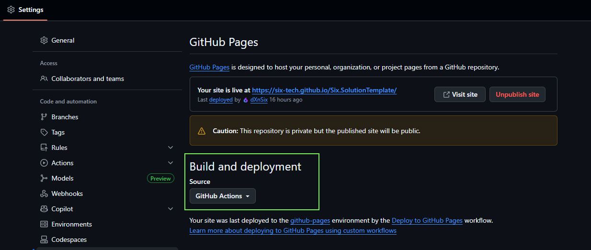
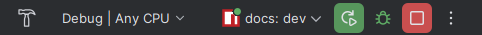

import {Aside, Tabs, TabItem, Steps} from '@astrojs/starlight/components'

# Introduction

The documentation system is designed to be automatically configured during project setup, but you can also set it up
manually or customize it to fit your specific needs.

<Aside type="tip">
    **Quick Setup**: If you're using the `setup.cs` script to initialize your project, most documentation configuration
    is handled automatically. You can skip to the customization sections if you've already run the setup script.
</Aside>

# Setup

The setup process involves configuring GitHub Pages for hosting and setting up the documentation structure in your repository.
This section covers both automatic setup via the setup script and manual configuration options.

## Setting Up GitHub Pages

To enable GitHub Pages for your documentation, you need to enable GitHub Pages in the **repository settings** and
set the **Build and deployment** source to **GitHub Actions**.

<Aside type="note">
    In **Free or Team** GitHub plans, the GitHub pages **are always public**. Only in **Enterprise** plan,
    GitHub pages can be private.
</Aside>

**GitHub repository settings / Build and deployment**



## Setting Up Repository Documentation

Once GitHub Pages is configured, you need to set up the documentation structure in your repository. The Six.SolutionTemplate provides both automatic and manual setup options to get your documentation system running quickly.

### Automatic Setup Using setup.cs

When setting up a solution using `setup.cs` script, the documentation is automatically configured for you based on
the repository (solution) name and the data you have provided.

After automatic configuration. you can additionally configure the documentation by editing the `astro.config.mjs`
file in the `docs/` directory root.


### Manual Setup

<Steps>

    1. **Navigate to docs directory** - Run `cd docs` in your terminal.

    2. **Install dependencies** - Run `pnpm install` to install required packages (you can use `npm install` also if
    you don't use pnpm for package management).

    3. **Configure `astro.config.mjs`** - In `docs/` directory root, open the `astro.config.mjs` and configure it as
    you wish.

</Steps>


# Development Workflow

## Local Development

<Steps>

    1. **Navigate to docs directory** - Run `cd docs` in your terminal.

    3. **Start development server** - Run `npm run dev` to start the local development server.

    4. **Open in browser** - Visit `http://localhost:4321` to see your changes in real-time.

</Steps>

## Building and Preview

Test your documentation before publishing:

<Tabs>
    <TabItem label="Build">
        ```bash
        # Build the documentation site
        pnpm run build
        ```
    </TabItem>
    <TabItem label="Development Server">
        ```bash
        # Runs the local development server (with hot reload)
        pnpm run dev
        ```
    </TabItem>
</Tabs>

**Note**: We are using the `pnpm` package manager for this project since it is faster and better handles packages. If 
you don't have it installed, you can install it using `npm install -g pnpm` or use the `npm` as usual.

### JetBrains Rider
If you are using **JetBrains Rider**, you can use the already configured run configurations to build and preview
the documentation (in the top-right corner of the screen).



The available run configurations are:

1. `docs: build` - Builds the documentation site.
2. `docs: dev` - Starts the local development server (with hot reload).


# Changing Documentation Images

By default, the documentation uses two hero images used on the `index.mdx` page and `introduction.md` page.
The images are located in the `docs/src/assets/` directory where you can replace them with your own images.


# Deployment

The documentation **automatically deploys to GitHub Pages when changes are pushed to the main branch.**
The deployment is handled by the GitHub Actions workflow in `.github/workflows/deploy-gh-pages.yml`.

<Aside type="note">
    **Automatic Deployment**: You don't need to manually deploy documentation. Every push to the main branch triggers an
    automatic build and deployment to GitHub Pages.
</Aside>